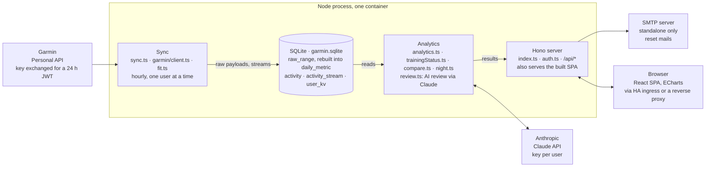

# PeakForm architecture

As of 2026-11-21

## Overview

PeakForm is a single Node application: one server pulls data from the Garmin Personal API, stores it in a SQLite file, analyses it and serves a React single-page app. There are no other services, no external database and no message broker.

The same application runs in two modes, which differ only in sign-in and configuration:

| Mode | Sign-in | Configuration | Master key |
| --- | --- | --- | --- |
| Home Assistant app (ingress) | Home Assistant, via `X-Remote-User-*` headers from the Supervisor proxy | App options in `peakform/config.yaml` | App option, or `/data/master.key` generated on first start |
| Standalone Docker | Username + password, optional password reset by mail | `.env` | `MASTER_KEY_FILE` (Docker secret) |

| Layer | Technology |
| --- | --- |
| Runtime | Node ≥ 24, TypeScript, built-in `node:sqlite` and `node:crypto` |
| HTTP server | Hono with `@hono/node-server` |
| Database | SQLite, one file under `/data` |
| AI reviews | Claude API via `@anthropic-ai/sdk`, with each user's own key |
| Mail | nodemailer (standalone only, password reset) |
| Frontend | React 19, Vite, ECharts, Leaflet, Tabler Icons |

## System overview

Data flows in one direction: Garmin, sync, SQLite, analytics, API, browser. The server talks only to Garmin, to Anthropic for reviews and, in standalone mode, to an SMTP server.

## Server

The server is about 4,000 lines of TypeScript in `server/`, with no framework beyond Hono. Modules call each other directly; there is no service or repository layer, and the analytics functions query the database themselves.

`index.ts` is the entry point. On startup it re-encrypts keys if needed (key rotation), migrates heart rate limits, resumes pending reviews, starts the HTTP server and calls `syncAll()`. After that an interval (60 min by default) purges expired sessions and syncs all users again.

| Area | Module | Purpose |
| --- | --- | --- |
| Entry | `index.ts` | Hono app, middleware, all `/api` routes, serving the SPA, sync timer |
| Entry | `config.ts` | Configuration from `/data/options.json` (HA) or environment variables |
| Entry | `cli.ts`, `reset-password.ts` | Command line: one-off sync for a user, set a password and rename an account |
| Garmin | `garmin/client.ts` | Exchange the API key for a 24 h JWT, token in memory, spaced requests with backoff |
| Garmin | `garmin/endpoints.ts` | Catalog of range, single and activity endpoints |
| Garmin | `garmin/fit.ts` | Own FIT decoder for records, laps and session (replaces Garmin's SDK for licensing reasons) |
| Sync | `sync.ts` | Queue across users, range fetches in 28-day chunks, activities and FIT downloads |
| Sync | `normalize.ts` | Flatten daily values from raw payloads, resolve curated metrics via candidate paths |
| Sync | `restingHr.ts`, `night.ts` | Resting heart rate and night view from the 2-minute heart rate samples |
| Storage | `db.ts` | Open SQLite, create the schema, per-user key-value store, transactions |
| Storage | `codec.ts` | Compact storage: Brotli for JSON, delta encoding for streams |
| Analytics | `analytics.ts` | Training load, mean-max curves, decoupling, heart rate limits, correlations, readiness |
| Analytics | `trainingStatus.ts` | Garmin-style training status from load, estimated VO2max trend and recovery signals |
| Analytics | `compare.ts` | Two activities on the same route on one distance axis |
| Analytics | `body.ts` | Reference weights (Broca) for the weight charts |
| Analytics | `review.ts`, `feedback.ts` | AI review via Claude, the athlete's own rating as prompt input |
| Security | `auth.ts` | Login, registration, password reset, sessions, `requireUser`, origin check |
| Security | `users.ts` | Accounts, passwords, e-mail, storing and verifying the Garmin key |
| Security | `crypto.ts`, `mail.ts` | Argon2id, AES-256-GCM with the master key, tokens, sending the reset mail |

The API under `/api` has about 40 endpoints in three groups. `/api/auth/*` works without a session. `/api/me/*` manages the account, keys and settings. The rest serve data to the pages, e.g. `/series`, `/load`, `/day`, `/night`, `/activities/:id`, `/compare`, `/correlations` and `/raw/:endpoint` for the Data tab.

## Sync data flow

The sync fetches raw data, stores it unchanged and rebuilds the daily values from it. Garmin has not published response schemas for the Personal API, so the raw payload is the source of truth and everything derived can be recomputed at any time.

Syncs are triggered by the timer (every `sync_interval_minutes`, 60 by default), the button in the app and `npm run sync`. All go into one queue that handles users one after another. Per user, `syncUser()` runs these steps:

1. **Token:** Decrypt the Garmin key and exchange it for a JWT. The token is valid for 24 hours and kept in memory only. If the exchange fails, the sync stops and the app shows the key error.
2. **Single values:** Profile and heart rate zones into `user_kv` (`single:*`).
3. **Ranges:** Seven range endpoints: daily summaries, sleep, HRV, stress, steps, Body Battery and weight. Each is fetched from its own cursor in 28-day chunks (weight 90), always refetching the last 3 days. The first run goes back `backfill_days` (365 by default). Each chunk is written to `raw_range` as Brotli-compressed JSON.
4. **Activities:** Summaries page by page from the search endpoint into `activity`. Then up to 150 pending FIT files per run, newest first: fetch the detail JSON, download the FIT file, decode it with `fit.ts`. Per-second streams go to `activity_stream`, laps and session to `activity.detail`.
5. **Resting heart rate:** Compute night and day values from the 2-minute samples (`restingHr.ts`), stored in `user_kv` (`resthr:<date>`).
6. **Normalize:** `rebuildDailyMetrics()` deletes the user's `daily_metric` rows and fills the table again. It finds every object with a calendar date in all raw payloads and stores each number in it under its path, e.g. `hrv.lastNightAvg`. The resting heart rate values are added too.
7. **Clean up:** Return free pages to the OS, truncate the WAL and write the result (`ok`, `partial`, `error`) to `sync_log`.

An error in a single endpoint only makes the run `partial`; the other data still arrives.

Pages don't query raw paths but curated metrics such as `rhr`, `hrv_night` or `sleep_score`. `CURATED` in `normalize.ts` maps each metric to a list of candidate paths, and the first one with data wins. If Garmin delivers a field under another name, only that list changes; the Data tab shows the mapping and the raw payloads.

## Storage

Everything PeakForm stores is in one SQLite file: `garmin.sqlite` in the data directory (`/data` in the container). A backup or a move is that file plus the master key. The database runs in WAL mode with foreign keys on. Every table with user data carries `user_id` and hangs off the user via `ON DELETE CASCADE`, so deleting an account removes all its data.

| Table | Content | Stored as |
| --- | --- | --- |
| `user` | Accounts: name, Argon2id hash (empty for HA users), `ha_user_id`, e-mail | Plain text, hash |
| `session` | Active sessions, 30 days | SHA-256 of the cookie only |
| `password_reset` | Reset links, 60 min, single use | SHA-256 of the token only |
| `garmin_credential` | Garmin key and last key error | AES-256-GCM |
| `user_kv` | Settings, heart rate limits, review profile, Anthropic key, sync cursors, profile, resting heart rate per day | JSON, keys encrypted |
| `raw_range` | Raw payloads of the range endpoints, one row per fetched chunk | Brotli JSON |
| `daily_metric` | Every number per day as `(date, path, value)`, rebuilt from `raw_range` | Numbers |
| `activity` | Summary, type, name, FIT status; detail with laps and session | JSON, detail as Brotli |
| `activity_stream` | Per-second streams: heart rate, power, speed, altitude, GPS, cadence | Delta-encoded |
| `activity_review` | AI review with status (`queued` to `done`, `error`, `quota`, `auth`) | JSON |
| `activity_feedback` | Own rating: feeling 1–5, planned session type, tags, note | Plain text |
| `sync_log` | Start, end, status and message of each sync run | Plain text |

`codec.ts` keeps the bulky columns small. Measured on real data (199 activities), streams shrink from 19.9 MB as JSON to 1.4 MB, and raw payloads about 13× with Brotli.

**Schema changes:** `PRAGMA user_version` is 1. New tables and columns are added without bumping it (`CREATE TABLE IF NOT EXISTS`, `ALTER TABLE ADD COLUMN`), so an older build can still open the same file. Any other version stops the server on startup.

**Secrets:** Garmin and Anthropic keys are encrypted with AES-256-GCM. Each write uses a random IV, and the user id is bound as AAD, so a ciphertext copied to another row will not decrypt. The master key lives outside the database, looked up in this order:

1. HA option `master_key` or `MASTER_KEY`
2. `MASTER_KEY_FILE` (the Docker secret in `docker-compose.yml`)
3. a `master.key` in the data directory, generated on first start

To rotate, put the old key in `MASTER_KEY_PREVIOUS`; on startup everything is re-encrypted with the new one.

## Analytics

All analytics are computed per request from the database, not stored in advance. The only exceptions are resting heart rate, computed during sync, and AI reviews. A changed formula therefore applies to the whole history at once.

| Analysis | Module | Core |
| --- | --- | --- |
| Training load | `analytics.ts` | Fitness (CTL) as a 42-day EWMA, fatigue (ATL) as a 7-day EWMA, form (TSB) = yesterday's CTL − ATL, ACWR = ATL / CTL. Load per activity from Garmin, otherwise Banister TRIMP. 120 days of warm-up. |
| Readiness | `analytics.ts` | HRV, resting heart rate, sleep score and form as z-scores against the user's own last 60 days, averaged and mapped to 0–100. Own model, not Garmin's. |
| Training status | `trainingStatus.ts` | Per day: ACWR (3-day mean), VO2max estimate (ACSM oxygen cost of grade-adjusted pace or power per kg, divided by the share of heart rate reserve, corrected to 80% HRR with the per-sport slope of estimate against intensity over the last year; median of 28 days, sport with more efforts), HRV status from the 7-day average against Garmin's baseline ranges, resting HR (3 days vs 60) and sleep score (3 nights). Rules map these to peaking … detraining; a new state needs 2 days, warnings show at once. Own model, not Garmin's. |
| Mean-max curves | `analytics.ts` | Best average power, speed or heart rate for 5 s to 2 h, resampled to 1 Hz |
| Aerobic decoupling | `analytics.ts` | Drift of heart rate against pace or power over a rolling window of moving time |
| Heart rate limits | `analytics.ts` | Upper limit per sport, fixed in bpm or as a share of heart rate reserve (Karvonen) with averaged resting heart rate |
| Correlations | `analytics.ts` | Pearson matrix of all metrics, same day or one day apart, plus a scatter for one pair |
| Day view | `analytics.ts` (`daySummary`), `night.ts` | All values of one calendar day, heart rate over day and night from the 2-minute samples |
| Resting heart rate | `restingHr.ts` | Lowest 30-minute average at night and during the waking day, instead of Garmin's single daily value |
| Route comparison | `compare.ts` | Two activities on the same route on one distance axis, smoothed, with the lead as a curve |

**AI review** (`review.ts`): A review is requested from the activity page and goes into a queue that works through one at a time. Pending entries survive a restart, as their status is stored in `activity_review`.

The prompt carries the activity with laps and decoupling, recovery before and after, training load, recent sessions, sex and age, the user's own goals and their rating from `feedback.ts`. The call uses the user's Anthropic key with Opus, Sonnet or Haiku (chosen in the settings) and asks for structured JSON against a fixed schema.

If the credit runs out or the key is invalid, the rest of that user's queue is parked and the app shows a notice.

## Users and sign-in

PeakForm is multi-user: each user stores their own Garmin key and sees only their own data. `requireUser` in `auth.ts` decides who the user is, differently per mode.

| | Home Assistant app | Standalone Docker |
| --- | --- | --- |
| Who authenticates | Home Assistant; the ingress proxy sends `X-Remote-User-Id`, `-Name` and `-Display-Name` | PeakForm itself, with username and password |
| Why it can be trusted | The server rejects every connection not coming from the Supervisor proxy 172.30.32.2 | Session cookie: 32 random bytes, `HttpOnly`, `SameSite=Lax`, `Secure` over HTTPS; only its SHA-256 is stored |
| Account creation | Automatic on first visit, as `ha.<name>` without a password | Registration, can be turned off with `ALLOW_REGISTRATION=false` |
| Passwords | none | Argon2id (19 MiB, 2 passes); 10 failed attempts per IP in 15 min, then 429 |
| Forgotten password | n/a | Reset link by mail (needs `SMTP_*` and `PUBLIC_URL`), otherwise `reset-password` on the server |
| CSRF protection | by the proxy | `SameSite` cookie plus an `Origin` vs. `Host` check on state-changing requests |

Behind a reverse proxy, `TRUST_PROXY=true` makes `X-Forwarded-For`, `-Proto` and `-Host` count. Per-IP throttling, the `Secure` flag and the origin check depend on them.

For a password reset, the token sits in the link's fragment, so it never reaches a server or a `Referer`. Only its hash is stored. The link is valid for 60 minutes and once, and a reset ends all sessions of the account. The response is the same for unknown accounts, so it reveals nothing.

When moving from Home Assistant to Docker, `reset-password` gives `ha.` accounts a password and renames them with `--rename`.

## Web app

The web app is a React SPA of about 7,000 lines in `web/src/`, with no router, state or UI library. It uses hash routing (`#/day`, `#/activities/123`) and relative URLs for assets and the API, so it runs unchanged under Home Assistant's changing `/api/hassio_ingress/<token>/` prefix.

| Page | Shows |
| --- | --- |
| Overview | Readiness, fitness, fatigue and form |
| Day | Tiles with the day's values and status, heart rate over day and night, the day's training |
| Recovery | HRV with its normal range, resting heart rate, Body Battery, sleep stages and score, stress |
| Health | Weight with reference, BMI, body composition |
| Training | Daily load, ACWR, weekly totals, best curve |
| Activities | List and detail: streams, map, decoupling, curve, replay, rating, AI review, comparison |
| Insights | Correlation matrix as a heatmap, scatter with trend line |
| Data | Mapping of curated metrics and raw payloads |
| Account | Garmin key, Anthropic key, review settings, heart rate limits, password, e-mail, account deletion |

Shared building blocks:

- **Data:** `api.ts` provides `api()`, `send()` and the `useApi()` hook. There is no global store; each page loads its own data. A 401 fires an event that returns to sign-in.
- **Preferences:** `prefs.ts` stores start tab, range, language and day view with the account. `localStorage` only keeps a copy for the sign-in screen.
- **Charts:** `Chart.tsx` wraps ECharts. Colors come from CSS variables and follow dark mode. Charts on a page share the crosshair through a group, and enlarged charts get zoom and a slider. Replay dots move every frame without rebuilding the chart. `Zoom.tsx` provides the large history chart behind a tile.
- **Tiles:** `TileViz.tsx` draws small SVG pictures per tile: line, bars, dots, diverging, band or ring. `status.ts` judges values against fixed ranges, goals or the user's own history.
- **Map:** `RouteMap.tsx` with Leaflet and OpenStreetMap tiles. `routeLayers.ts` colors the route by pace, heart rate, cadence or grade.
- **Language:** `i18n.tsx` holds all texts in English and German, typed by key, plus number and date formats.
- **Styling:** one `styles.css` with design tokens as CSS variables, no CSS framework.

## Build, release and operations

One container image serves both modes. The server detects at runtime whether it runs as an HA app, from `/data/options.json`.

**Development:** `npm run dev` starts two processes. Vite serves the app on port 8099 and proxies `/api` to the server on 8098 (`dev.env`). The `Host` header is kept, otherwise the origin check would reject every POST. The server runs with `tsx` and `--watch`.

**Build:** `npm run build` produces three things:

1. Vite builds the SPA into `dist/web`.
2. `tsc` builds the server into `dist/server`.
3. `scripts/notices.mjs` collects the license texts of the shipped libraries.

**Image:** The `Dockerfile` has two stages on `node:24-alpine`. The first runs `npm ci`, the build and `npm prune --omit=dev`; the second holds only `dist`, the runtime dependencies and `package.json`. Frontend libraries such as React and ECharts are `devDependencies`, as they are already in the bundle. Port 8099, volume `/data`.

**CI:** `.github/workflows/build.yml` runs on every push to `main` and on `v*` tags:

1. Fails if `CHANGELOG.md` and `peakform/CHANGELOG.md` differ.
2. Builds the image for amd64 and arm64.
3. Publishes it as `ghcr.io/benjenjones/peakform`, tagged with the version from `peakform/config.yaml` and `latest`.

**Release:** Write a CHANGELOG entry with a release name and copy it with `npm run changelog`, bump the version in `package.json`, `package-lock.json` and `peakform/config.yaml`, push to `main`. Home Assistant only offers an update when the version in `config.yaml` changes.

| Path | Content |
| --- | --- |
| `repository.yaml` | Makes the GitHub repo a Home Assistant app repository |
| `peakform/config.yaml` | HA app: image, ingress on 8099, `backup: cold`, options `master_key`, `backfill_days`, `sync_interval_minutes` |
| `peakform/DOCS.md`, `CHANGELOG.md`, icons | What Home Assistant shows in the app store |
| `docker-compose.yml` | Standalone: port 8099, `.env`, `./data` as volume, master key as a Docker secret |

`backup: cold` stops the app during an HA backup, so the SQLite file and its WAL are copied consistently.

## Decisions and trade-offs

Most decisions keep operations small: one process, one file, no outside services beyond Garmin and, optionally, Anthropic and SMTP.

| Decision | Why | Cost |
| --- | --- | --- |
| SQLite via `node:sqlite` instead of Postgres | One file to back up and move, no dependency, fits the HA app | One process, no horizontal scaling; irrelevant for a handful of users |
| Store raw payloads, rebuild daily values | Garmin has not published schemas; a wrong field name is one entry in `CURATED` | More storage, `daily_metric` is rebuilt in full on every sync |
| Compute analytics per request | Formula changes apply to the whole history at once, no cache to invalidate | Compute per request, e.g. 120 days of warm-up for training load |
| One sync at a time, 300 ms between requests | Garmin has not documented rate limits; load stays predictable | A large backfill spreads over several runs (150 FIT files per run) |
| Own FIT decoder | Garmin's SDK license does not allow redistributing it in the public image | Reads only the fields PeakForm uses |
| Keys encrypted with a master key outside the DB | A leaked database backup does not reveal keys | Whoever has the running server has the keys too; in exchange, sync runs without users signed in |
| Each user's own Anthropic key, no subscription logins | Everyone pays for their own reviews; Anthropic does not allow apps to use subscription tokens of their users | Users need a Console account |
| Hash routing and relative URLs | Works under HA's dynamic ingress prefix without configuration | URLs contain `#` |
| No UI, state or CSS library | Few dependencies, full control over the look | Components like `Dialog` are hand-built |
| ECharts for all charts | Canvas for thousands of stream points, built-in zoom, synced crosshair, heatmap, cheap replay markers | Option objects instead of JSX; large share of the bundle |

**Known unknowns:** The Personal API has been available since October 2026. Rate limits, the maximum range per request and the response schemas are undocumented, hence the cautious spacing, 28-day chunks and candidate paths.
